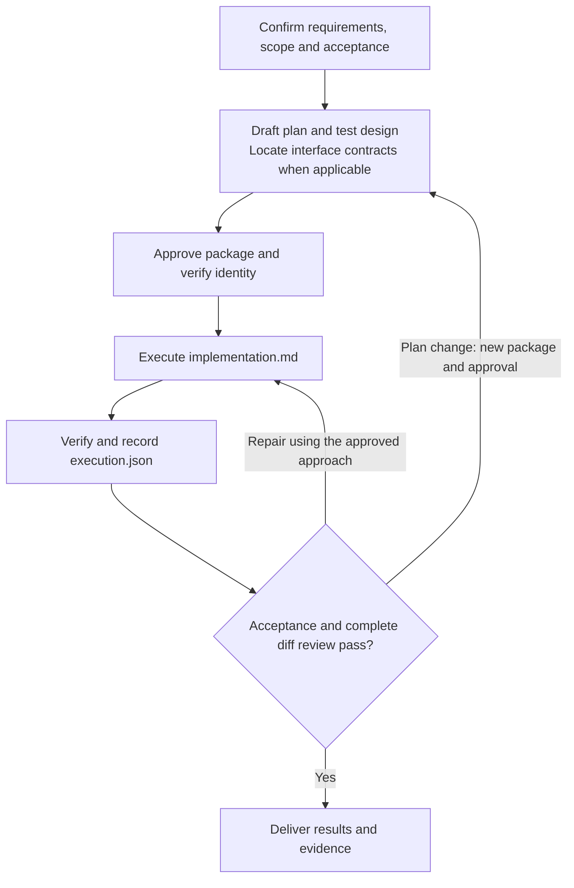

# AI Development Workflow Skill

English | [繁體中文](README.md)

An open-source Agent Skill for Codex and Claude Code, focused on executable requirement plans, test design, and delivery consistency reviews. It can also coordinate end-to-end implementation and verification under an approved plan.

## Technology and Compatibility

- Skill format: Agent Skills (`SKILL.md`)
- Supported tools: Codex and Claude Code
- Documentation formats: Markdown, JSON, JSON Schema, and YAML
- Publication validation: Bash and the Python 3 standard library
- Version control and review: Git

## Four Modes

- **Requirement planning**: Define goals, boundaries, impact, reuse, risks, implementation slices, and acceptance criteria. Existing relevant domain context and ADRs are read when present, but never created just to satisfy the workflow.
- **Test design**: Cover applicable success, boundary, failure, and regression scenarios, then map them to automated and manual verification.
- **Git diff review**: Independently inspect Spec/scope compliance and Standards/engineering quality, then verify and deduplicate findings into stable `REV-*` IDs with high, medium, or low severity.
- **Full workflow**: Complete the plan, test design, and applicable interface contract; approve the package; then implement, verify, record execution evidence, and review the complete diff.

AI collaboration metrics and local timing are disabled by default. They are enabled only when the user explicitly asks for them or the target repository requires them.

## Full Workflow

This diagram covers full delivery. A request for planning, test design, or Git diff review alone runs only that selected mode.



Missing approval or required input blocks execution. Approved formal documents remain immutable; results belong in `execution.json`. Changes to scope, interfaces, or implementation steps require a new package and approval. See the [plan-package contract](skills/ai-development-workflow/references/plan-package.md) for identity, workspace isolation, and recovery rules.

## Requirement Planning Features

Each new requirement uses `docs/plans/YYYY-MM-DD-<topic>/`:

```text
docs/plans/YYYY-MM-DD-<topic>/
├── design.md
├── delivery.md
├── implementation.md
├── test-design.md
├── manifest.json
├── execution.json
├── contracts/                 # Conditional interface artifacts
│   ├── api.md
│   ├── operation.request.schema.json
│   └── operation.response.schema.json
└── tasks/                     # Conditional approved-plan projections
    └── S-01.md
```

| Artifact | Purpose |
| --- | --- |
| `design.md` | Background, selected approach, architecture, data flow, and interfaces |
| `delivery.md` | Scope, current evidence, `AC-*`, and acceptance criteria |
| `implementation.md` | Exact files, steps, commands, expected results, and dependencies; the execution entry point |
| `test-design.md` | Test matrix, data, assertions, and planned `RUN-*` verification methods |
| `manifest.json` | Approval identity, formal-file SHA-256 hashes, and execution policies |
| `execution.json` | Actual status, commands, automated/manual evidence, deviations, and results |

- `contracts/`: create it only for interface changes without an existing authoritative source. Otherwise retain an exact source/version reference. Schemas provide Chinese field titles/descriptions, typed examples, and applicable Apifox mock rules; the same contract drives implementation acceptance. See [interface contracts and acceptance](skills/ai-development-workflow/references/api-contract.md).
- `tasks/`: absent by default; derive it from the approved plan only when parallel, cross-session, cross-repository, or high-risk isolation work needs it.
- `docs/plans/` is Git-ignored and must not be committed. Legacy flat plans are read-only inputs, never moved or deleted automatically; execution requires a new approved package.
- Keep small requests compact. Legacy documents retain the six core plan headings as historical reading guidance; new packages separate artifact responsibilities, and eligible small test designs can use five core test-design headings.
- Trace acceptance, Tasks, cases, data, and verification with `AC-* → S-* → T-* → D-* / RUN-*`. See [requirement planning](skills/ai-development-workflow/references/requirement-plan.md) and [test design](skills/ai-development-workflow/references/test-design.md).

## External Workflow Integration

- Proactive discovery accepts only the current platform catalog metadata; an explicit invocation context retains the capability already invoked in the task. Discovery is not activation and does not scan installed Skills.
- With zero, one, or multiple capabilities pending verification, expand only the necessary contracts. Metadata filtering does not itself create a candidate: availability, authorization, side effects, ownership, and verifiable value must pass. Use the native workflow when none qualify.
- Model-invoked capabilities follow the platform contract. User-invoked capabilities provide one currently executable handoff action and pause, then revalidate the return. Show necessary handoff information only when the user must act, authorize, resolve a conflict, or safely resume across tasks.
- The cross-provider composition rule requires non-overlapping slots or an explicit upstream/downstream relationship and an artifact handoff contract. Formal artifacts keep one writable owner. A sufficient plan is not sent to a ticket generator by default; exit extra orchestration when one workflow already covers the request.
- The integration never installs, sets up, initializes, commits, archives, deletes, performs remote writes, or publishes automatically. Local commits follow the approved policy; push, PR, merge, release, deployment, and other remote writes still need separate authorization.

Superpowers can read `implementation.md` and execute the approved mode after passing the [compatibility matrix](skills/ai-development-workflow/references/plan-package.md#superpowers-相容性矩陣). Detailed rules live in [Skill orchestration](skills/ai-development-workflow/references/skill-orchestration.md) and [Provider integration](skills/ai-development-workflow/references/workflow-integration.md).

## Reference Timing and Productivity

- Metrics and timing are disabled by default; enable them only on explicit request or repository policy.
- The optional Python 3 standard-library helper records closed intervals locally, pauses for user/CI waits, and uses no background service or upload. Missing Python disables timing while the core workflow continues.
- Lock the corresponding PERT baseline before implementation. Only complete, comparable coverage produces a reference time-saving percentage; report partial or unknown coverage without turning it into whole-requirement savings.
- Measure time only; never collect, estimate, or report token usage. Added scope uses independent segments, and a new conversation does not resume old measurements.

Commands, optional ActivityWatch use, and evidence recording are defined in the [reference timing guide](skills/ai-development-workflow/references/reference-timing.md).

## Installation

### Recommended: skills CLI

Node.js and `npx` are required:

```bash
npx skills add https://github.com/xiewxin/ai-development-workflow-skill.git \
  --skill ai-development-workflow
```

To install globally for Codex and Claude Code:

```bash
npx skills add https://github.com/xiewxin/ai-development-workflow-skill.git \
  --skill ai-development-workflow \
  -g -a codex -a claude-code -y
```

Open a new conversation after installation so the tool can load the Skill.

### Codex built-in installer

```bash
python3 "${CODEX_HOME:-$HOME/.codex}/skills/.system/skill-installer/scripts/install-skill-from-github.py" \
  --repo xiewxin/ai-development-workflow-skill \
  --path skills/ai-development-workflow
```

### Manual copy

From the repository root:

```bash
mkdir -p ~/.codex/skills
cp -R skills/ai-development-workflow ~/.codex/skills/ai-development-workflow
```

For Claude Code:

```bash
mkdir -p ~/.claude/skills
cp -R skills/ai-development-workflow ~/.claude/skills/ai-development-workflow
```

## Usage Examples

- “Create a requirement plan for this change, but do not implement it yet.”
- “Create a test design from the current design and delivery criteria, including test data and regression scope, then submit the complete package for approval.”
- “Review the complete Git diff against the target branch.”
- “Use the full workflow for this request. If the current platform provides a collaboration Skill with verifiable value, give me one explicit handoff only when I need to act or authorize it.”
- “Complete this feature using the full workflow, and pause for plan approval, required user actions, additional authorization, or conflict resolution.”

## Updating

From the project root, update only the project-level installation:

```bash
npx skills update ai-development-workflow -p
```

For a global installation:

```bash
npx skills update ai-development-workflow -g
```

Open a new conversation after updating.

## Publication Validation

```bash
python3 -m unittest discover -s tests -p "test_*.py" -v
bash tests/test-validate-publication.sh
bash scripts/validate-publication.sh
git diff --check
```

In repository mode, the validator checks the public working tree while excluding `.git`, `.idea`, and the explicitly Git-ignored process-artifact directories `docs/plans/` and `docs/specs/`. Similar public directories remain in scope. It validates the Skill structure, metadata, timing script, relative Markdown links, required template fields, Traditional Chinese repository documents, and likely sensitive information, reporting only file paths, rules, and necessary line numbers without echoing matched content.

The Skill's interaction language follows the user. Generated files and code follow the target repository's rules and nearby conventions. The Traditional Chinese publication check protects this repository's public Chinese documents and does not impose that language on target repositories.

These checks validate public documents, templates, and validator behavior. Real interfaces, Provider calls, external approval, and workspace isolation need evidence from the corresponding task. Valid Schema examples or mocks do not establish acceptance of the real implementation.

## Security and Privacy

- Public examples use fictional, neutral data.
- Do not commit real business data, personal information, credentials, internal URLs, or local machine paths.
- Publication validation is a safety aid and does not replace manual diff review or GitHub Secret Scanning.

## License

This project is available under the [MIT License](LICENSE).
