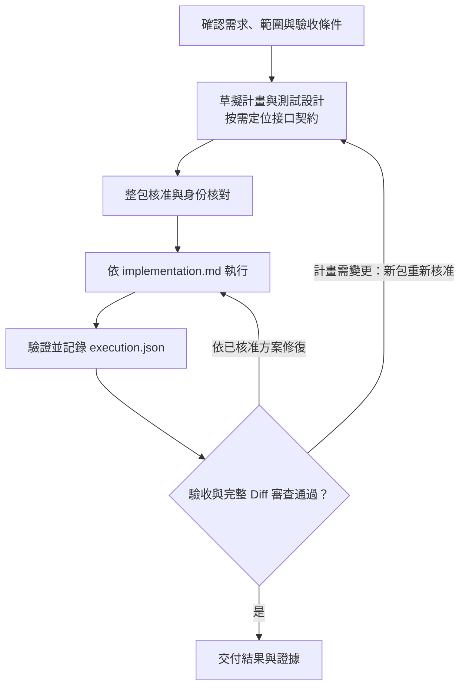

# AI Development Workflow Skill

[English](README.en.md) | 繁體中文

這是一個支援 Codex 與 Claude Code 的公開 Skill，核心交付是可執行的需求計畫、測試設計與交付一致性審查，並可依核准計畫協調端到端實作與驗證。

## 技術與相容性

- Skill 格式：Agent Skills（`SKILL.md`）
- 支援工具：Codex、Claude Code
- 文件格式：Markdown、JSON、JSON Schema、YAML
- 發布驗證：Bash、Python 3 標準函式庫
- 版本管理與審查：Git

## 四種模式

- **需求計畫**：整理目標、邊界、影響、複用、風險與驗收方式；存在且相關時會讀取領域 `CONTEXT` 與 ADR，缺少時不強制建立。AI 協作成效與本機計時預設關閉，只有使用者明確要求或目標倉庫政策要求時才加入並量化。
- **測試設計**：設計正常、邊界、異常與回歸情境，並對應自動化與手動驗證。
- **Git Diff 審查**：分別檢查 Spec／範圍與 Standards／工程品質，驗證並去重後使用目前需求對話內穩定的 `REV-*` 編號、高／中／低嚴重度與狀態追蹤問題。
- **完整流程**：先完成計畫、測試設計與適用的接口契約，整包核准後實作，再驗證、回填執行證據與審查完整 Diff。

## 完整流程

下圖適用於完整流程；只要求需求計畫、測試設計或 Git Diff 審查時，只執行指定模式。



沒有有效核准或必要輸入時先停下。核准後的正式文件保持不可變；結果寫入 `execution.json`，範圍、接口或實作步驟需要變更時建立新包重新核准。具體身份、隔離工作區與恢復規則見[計畫包合同](skills/ai-development-workflow/references/plan-package.md)。

## 需求計畫特性

每個新需求使用 `docs/plans/YYYY-MM-DD-<topic>/`：

```text
docs/plans/YYYY-MM-DD-<topic>/
├── design.md
├── delivery.md
├── implementation.md
├── test-design.md
├── manifest.json
├── execution.json
├── contracts/                 # 條件式，按需建立接口文件
│   ├── api.md
│   ├── operation.request.schema.json
│   └── operation.response.schema.json
└── tasks/                     # 條件式，從核准計畫派生
    └── S-01.md
```

| 文件 | 用途 |
| --- | --- |
| `design.md` | 背景、選定方案、架構、資料流與接口 |
| `delivery.md` | 範圍、現況證據、`AC-*` 與驗收條件 |
| `implementation.md` | 精確檔案、逐步操作、命令、預期結果與依賴；執行者從這裡開始 |
| `test-design.md` | 測試矩陣、資料、斷言與預計 `RUN-*` 驗證方式 |
| `manifest.json` | 核准身份、正式文件 SHA-256 與執行策略 |
| `execution.json` | 實際狀態、命令、自動化／人工驗收證據、偏差與結果 |

- `contracts/`：只有接口新增或變更、且沒有既有權威來源時才建立；已有來源保存精確引用與版本。Schema提供中文字段說明、型別正確的示例及適用的Apifox Mock，同一契約用於實作驗收。詳見[接口契約與驗收](skills/ai-development-workflow/references/api-contract.md)。
- `tasks/`：預設不生成；並行、跨會話、跨倉庫或高風險隔離有需要時，才從已核准計畫派生。
- `docs/plans/` 是Git忽略的過程產物，不得提交。舊平鋪計畫只讀相容，不自動搬移或刪除；實作前補成新包並重新核准。
- 小型需求保持緊湊。舊平鋪格式的六個核心標題只保留歷史讀取語義；新包按文件職責拆分，符合條件的小型測試設計可用五個核心標題。
- 以 `AC-* → S-* → T-* → D-*／RUN-*` 串接驗收、Task、案例、資料與驗證。詳細方法見[需求計畫](skills/ai-development-workflow/references/requirement-plan.md)與[測試設計](skills/ai-development-workflow/references/test-design.md)。

## 外部工作流整合

- 主動發現僅接受平台本輪提供的 Skill catalog metadata；顯式調用上下文沿用目前任務已實際調用的能力。發現不等於啟用，不掃描本機安裝。
- 待核驗能力為零／一／多項時按需展開；metadata 初篩不直接建立候選，先核驗可用性、授權、副作用、所有權與可驗證增益。沒有合格能力時使用原生流程。
- Model-invoked能力依平台合同調用；User-invoked能力提供一項目前平台可執行的顯式調用指示並暫停，返回後重新驗證。只有使用者需要行動、授權、裁決或跨任務恢復時才顯示必要交接。
- 跨 Provider 能力組合須有不重疊的能力槽或明確上下游，並具備產物交接合同；正式產物只有一個可寫所有者。計畫足以直接執行時不預設產生 tickets；單一工作流已完整覆蓋需求時退出多餘橋接。
- 整合不會自動安裝、setup、初始化、提交、封存、刪除、遠端寫入或發布。本地commit依核准策略；push、PR、merge、release、部署及其他遠端寫入仍需獨立授權。

Superpowers可讀取 `implementation.md`，通過[相容性矩陣](skills/ai-development-workflow/references/plan-package.md#superpowers-相容性矩陣)後按核准模式執行。完整規則見[Skill編排合同](skills/ai-development-workflow/references/skill-orchestration.md)與[Provider整合](skills/ai-development-workflow/references/workflow-integration.md)。

## 參考計時與提效

- AI 協作成效與參考計時預設關閉；只有使用者明確要求 AI 成效／提效，或目標倉庫政策要求時才啟用。
- 可選Python 3標準函式庫工具只在本機記錄閉合時間區間；等待使用者或CI時暫停，不啟動背景服務、不上傳資料。Python不可用時停用計時，核心流程繼續。
- 實作前鎖定對應範圍的PERT基準；只有覆蓋完整且可比時才輸出參考工時節省比例。局部範圍、部分或未知覆蓋如實標示，不能推為整案提效。
- 成效只量化時間；不收集、不估算、不輸出Token用量。新增範圍分段記錄，新對話不續接舊計量。

命令、ActivityWatch選用與回填方式見[參考計時指南](skills/ai-development-workflow/references/reference-timing.md)。

## 安裝

### 推薦：使用 skills CLI

環境需具備 Node.js 與 `npx`。執行以下命令後，可互動選擇安裝到哪些 AI 工具、目前專案或全域環境，以及使用 symlink 或 copy：

```bash
npx skills add https://github.com/xiewxin/ai-development-workflow-skill.git \
  --skill ai-development-workflow
```

若要直接全域安裝到 Codex 與 Claude Code，可使用非互動命令：

```bash
npx skills add https://github.com/xiewxin/ai-development-workflow-skill.git \
  --skill ai-development-workflow \
  -g -a codex -a claude-code -y
```

安裝後重新開啟對話，讓工具載入新的 Skill。

### 交給 AI 安裝

可以將以下內容直接交給支援命令執行的 AI 工具：

```text
請參考 https://github.com/xiewxin/ai-development-workflow-skill#安裝，
幫我安裝 Skill：ai-development-workflow。
若我尚未指定，請先依序確認要安裝到哪些 AI 工具，以及安裝到目前專案或全域環境。
```

代理應先檢查 `npx` 是否可用；確認 AI 工具與安裝範圍後，再以包含 `-a`、必要時的 `-g`，以及 `-y` 的 `npx skills add` 命令完成安裝，不應未經確認直接採用預設值。

### 替代方式

#### Codex 官方安裝器

可使用 Codex 內建的官方 `skill-installer` 從 `xiewxin/ai-development-workflow-skill` 安裝 `skills/ai-development-workflow`：

```bash
python3 "${CODEX_HOME:-$HOME/.codex}/skills/.system/skill-installer/scripts/install-skill-from-github.py" \
  --repo xiewxin/ai-development-workflow-skill \
  --path skills/ai-development-workflow
```

#### 手動複製

在已取得本倉庫內容的根目錄執行。

Codex：

```bash
mkdir -p ~/.codex/skills
cp -R skills/ai-development-workflow ~/.codex/skills/ai-development-workflow
```

Claude Code：

```bash
mkdir -p ~/.claude/skills
cp -R skills/ai-development-workflow ~/.claude/skills/ai-development-workflow
```

`SKILL.md` 遵循 Agent Skills 格式，Codex 與 Claude Code 共用同一份內容，無需維護兩份 Skill。

## 使用範例

- 「請先整理這個功能的需求計畫，暫時不實作。」
- 「依目前設計與交付條件建立測試設計，包含資料策略與回歸範圍，完成後一併送整包核准。」
- 「請以目標分支為基準審查完整 Git Diff。」
- 「請用完整流程處理目前需求；如果平台本輪提供能帶來可驗證增益的協同 Skill，請在需要我操作或授權時給我一項明確交接。」
- 「需求已完成，請回填可驗證的 AI 協作貢獻，並依已鎖定 PERT 與本機計量摘要計算參考提效。」
- 「請完成這個需求；在計畫核准、需要我操作、額外授權或衝突裁決時停下。」

## 更新

使用skills CLI安裝時，在專案根目錄執行以下命令，只更新專案級安裝：

```bash
npx skills update ai-development-workflow -p
```

更新全域安裝時改用 `-g`：

```bash
npx skills update ai-development-workflow -g
```

手動安裝時，取得最新版本並檢視差異，再以新的 `skills/ai-development-workflow` 取代本機同名目錄。更新後重新開啟對話，讓工具載入新版本。

## 發布前驗證

```bash
python3 -m unittest discover -s tests -p "test_*.py" -v
bash tests/test-validate-publication.sh
bash scripts/validate-publication.sh
git diff --check
```

validator 在倉庫模式掃描公開工作目錄（排除 `.git`、`.idea` 及明確定義為 Git 忽略過程產物的 `docs/plans/`、`docs/specs/`），檢查 Skill 結構、元資料、參考計時腳本、Markdown 相對連結、計畫包 Markdown／JSON 範本、可選 AI 成效範本的完整欄位、繁體中文及疑似敏感資訊。其他相似目錄不會被排除；錯誤只列出相對路徑、規則與必要行號，不回顯命中內容。

Skill 執行時的互動語言跟隨使用者，文件與程式碼跟隨目標倉庫規範；本倉庫 publication validator 的繁體中文檢查只保護本倉庫公開文件，不會把繁體中文強制套用到其他目標倉庫。

這些檢查驗證公開文件、範本與validator行為；真實接口、Provider調用、外部核准及工作區隔離仍須在對應任務中取得證據。Schema示例或Mock通過，不代表真實實作已通過驗收。

## 語言 allowlist

若公開的固定外部合同必須保留原始詞彙，可在本機根目錄建立 `.publication-language-allowlist`，每行格式為：

```text
<相對檔案路徑>|<完整固定合同詞>
```

空行與以 `#` 開頭的說明會被忽略。allowlist 只放行指定檔案的指定語言詞；憑證、個資、內部網路與本機路徑等安全規則仍會阻擋。此檔案只留在本機，不應發布。

## 安全與隱私

- 公開範例僅使用虛構、中立資料；請勿提交真實業務資料、個資、憑證、內部網址或本機路徑。
- 發布檢查僅為輔助，不能取代人工差異審查與 GitHub Secret Scanning。

## License

本專案採用 [MIT License](LICENSE)。
